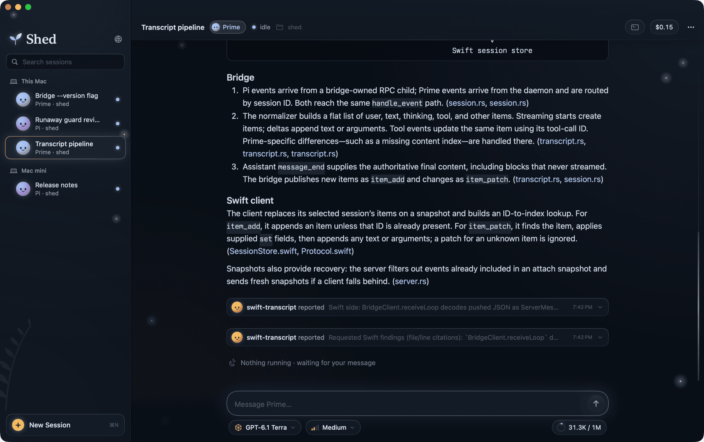
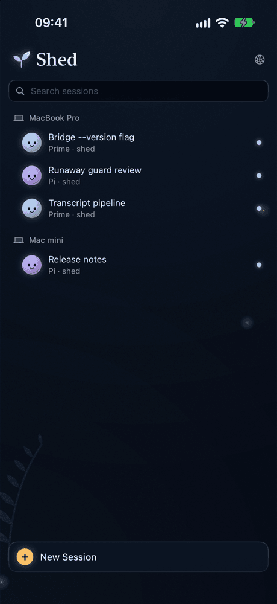
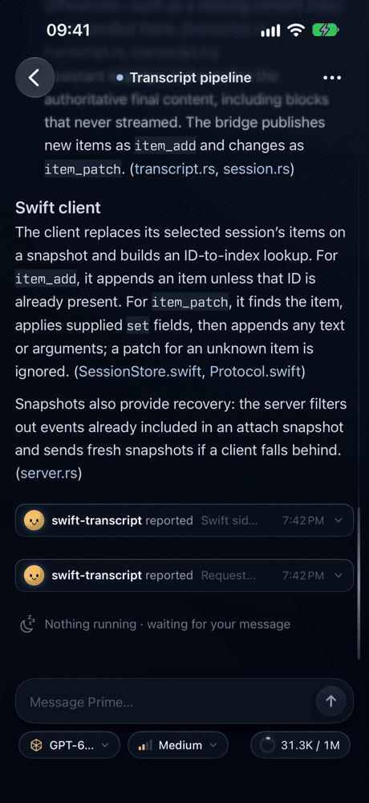

# Shed

Shed lets you run coding agents on your Macs and drive them from anywhere. It works with [Pi](https://pi.dev), [Prime Agent](https://app.primeintellect.ai/prime-agent) and [DeepSeek Harness](https://www.npmjs.com/package/@deepseek-ai/dsh), all through [Open Codex](https://opencodex.me): start a session on your desk machine, watch it think and run tools from your phone, and steer it.

<p align="center">
  
</p>

<p align="center">
  
  &nbsp;&nbsp;
  
</p>

## What it does

- **One session list for every computer.** Sessions from each Mac running the bridge, Pi, Prime and DeepSeek Harness side by side, including Prime sessions started in its own TUI.
- **The full transcript, live.** Reasoning, tool calls and their output, file edits, images and audio stream in as the agent works.
- **Steer while it runs.** Messages sent during a turn steer it; the rest queue. Stop, compact, and switch model, reasoning effort or context window from the composer.
- **Subagents and background commands.** Child sessions show under their parent and open like any other. Shell commands an agent leaves running are listed with live output and can be cancelled.
- **Context and cost at a glance.** A gauge for the context window, and the session's spend so far, as Open Codex measures it.
- **Runaway protection.** The bridge stops a reply that has degenerated into whitespace or the same few characters repeated, and tells the agent why.
- **Web search and page reading.** Every agent can search the web and read any page as Markdown through the bridge's provider (Firecrawl), each in its own way.
- **On the iPhone,** a Live Activity follows a running session from the Lock Screen and the Dynamic Island, with what it spends a minute.
- **One set of models for every agent.** Every agent offers exactly the models Open Codex serves: API keys and a ChatGPT subscription set up once there show up as separate choices in all of them.

## How it works

```
 iPhone app ─┐                                         ┌─ pi --mode rpc      one process per Pi session
             ├─ WebSocket over Tailscale ──► bridge ───┼─ dsh                one process per DeepSeek Harness session
 Mac app ────┘                              (:7878)    └─ Prime daemon       every Prime session and subagent
```

Each computer runs the **bridge**, a small Rust service that drives the agents installed there and turns them into one protocol. The agents reach their models through **Open Codex** on `127.0.0.1:10100`: the bridge writes its catalog into each agent's configuration, and reads its request history for what each session spends. The **apps** connect to one or more bridges. The bridge listens on `127.0.0.1` only; [Tailscale](https://tailscale.com) makes it reachable from your other devices, privately and over HTTPS. Sessions belong to the agents, not to Shed: quit the app and they keep running. Prime's sessions live in its own daemon, so they also outlive a restart of the bridge; Pi's and DeepSeek Harness's stop with the bridge and resume from their saved transcript.

[docs/architecture.md](docs/architecture.md) covers the design in more depth.

## Requirements

- macOS 15 or later on each computer that runs agents, with the Xcode command line tools (`xcode-select --install`).
- An API key for at least one model provider (OpenAI, Anthropic, Mistral, DeepSeek, Google, OpenRouter), or a ChatGPT subscription.
- [Tailscale](https://tailscale.com/download), to reach the bridge from another device. Not needed to use the Mac app on the same Mac.
- For the iPhone app: iOS 18 or later, and Xcode with an Apple account (a free one works).

The installer takes care of Open Codex, Rust, Pi, Prime Agent, DeepSeek Harness and, through Homebrew when available, Node.

## Getting started

### 1. Install on a Mac

```bash
git clone https://github.com/fontanierh/shed.git && cd shed
setup/install.sh
```

Run in a terminal, it walks through each part and asks for what is missing. Keys can also come from the environment (`OPENAI_API_KEY`, `ANTHROPIC_API_KEY`, `MISTRAL_API_KEY`, `DEEPSEEK_API_KEY`, `GEMINI_API_KEY`, `OPENROUTER_API_KEY`, and `FIRECRAWL_API_KEY` for [web search](#web-search-and-page-reading)). The script:

- **Open Codex.** Uses the one already on the Mac as it is, or installs the release Shed is tested with, and applies Shed's fixes that Open Codex hasn't released yet (`setup/opencodex/`). It runs as Open Codex's own login service. Each API key you give goes to Open Codex alone. Then it offers to sign in to a ChatGPT subscription (`ocx account login openai`) in the browser. The OpenAI key and the subscription show as separate models: `openai-apikey/…` is billed to the key, and bare ids such as `gpt-6.1-terra` go to the subscription. Claude comes from the Anthropic API key (`anthropic-apikey/…`) only: a Claude subscription is meant for Anthropic's own apps, so the bridge leaves out any Claude subscription signed in to Open Codex.
- **Agents.** Installs or updates Pi, Prime Agent and DeepSeek Harness, makes GPT-6.1 Terra the default where none is set, and installs Pi's subagent and background-jobs extensions.
- **Bridge.** Builds the bridge and registers it as a login service on `127.0.0.1:7878`.
- **Mac app.** Installs `~/Applications/Shed.app`.
- **Tailscale.** Publishes the bridge on your tailnet (see below).
- **iPhone app.** With `SHED_TEAM_ID` set, or on request, builds it onto a connected iPhone (see step 3).

It ends with a summary of each part. It is safe to run again, and that is how you update: every step updates in place and leaves settings it doesn't own alone. `--no-app`, `--no-service`, `--no-tailscale` and `--no-iphone` skip those steps. `--no-opencodex` gives Pi and Prime your keys directly instead (the OpenAI, Anthropic, Gemini and DeepSeek ones, from the environment), and leaves every agent's own providers in place.

Keys, subscriptions and models are managed afterwards in the Open Codex dashboard at http://localhost:10100. A model added there shows in every agent's list the next time you start a session (the lists are kept for a minute).

Open **Shed** from `~/Applications`. On the Mac that runs the bridge, the app finds it and its token on its own.

### 2. Reach it over Tailscale

The bridge executes whatever the agents decide to run, so it never listens on a network interface. Tailscale gives your devices a private network (a *tailnet*) and lets the bridge join it without opening a port:

1. Install Tailscale on the Mac (`brew install --cask tailscale`, or from the App Store) and on your iPhone, and sign in to the same account on both.
2. In the [admin console](https://login.tailscale.com/admin/dns), enable **MagicDNS** and **HTTPS Certificates**, so the Mac gets a name and a certificate on the tailnet.
3. Run `setup/install.sh` again if Tailscale wasn't set up the first time. It runs

   ```bash
   tailscale serve --bg --https=7878 http://127.0.0.1:7878
   ```

   which serves the bridge at `wss://<mac>.<tailnet>.ts.net:7878/ws`, to devices on your tailnet only. Port 7878 keeps it clear of anything you already serve on 443.

The installer ends by printing that address, and the command that prints the bridge's token:

```bash
plutil -extract token raw -o - ~/.agent-remote/config.json
```

Every connection must present this token, in addition to coming from your tailnet.

### 3. Install the iPhone app

The iPhone app is built from source with your own Apple account. Connect the iPhone by cable once, turn on Developer Mode (Settings › Privacy & Security), and find your team ID in Xcode › Settings › Accounts. Then:

```bash
apps/scripts/install-iphone.sh <TEAM_ID> com.<you>.shed
```

(`SHED_TEAM_ID=<TEAM_ID> SHED_BUNDLE_ID=com.<you>.shed setup/install.sh` does the same as part of the setup.) On first launch, enter the address and token from step 2. With a free Apple account the app must be reinstalled every 7 days; a paid developer account extends that to a year.

### 4. Add more computers

Run `setup/install.sh` on each Mac that should run agents, then add it in the apps: the network button next to the Shed title (⌘, on the Mac) opens **Computers**, where **Add Computer** takes its address and token. Sessions from all of them share one list, grouped by computer.

To keep a remote Mac's bridge in step with your checkout, run this from your own Mac over SSH:

```bash
setup/sync-remote.sh user@host            # build, sign, copy over, restart the bridge if it changed
setup/sync-remote.sh user@host --watch    # and repeat every 5 minutes from launchd
```

It keeps its copy of the source in `~/.agent-remote/sync` on that Mac, apart from any clone of the repository there.

### Folder access and stuck commands

macOS asks before a program first reads Documents, Desktop or Downloads, and holds the read until someone answers on that Mac. Commands an agent runs count as the bridge's, so the prompt names `agent-remote`. Grant it once, in System Settings › Privacy & Security › Full Disk Access (add `~/.agent-remote/bin/agent-remote`), or answer each prompt as it comes.

The answer sticks across updates only if the bridge keeps the same signature. The installer and `sync-remote.sh` sign it with the first Developer ID or Apple Development certificate in your keychain (set `SHED_SIGN_IDENTITY` to choose one). Without a certificate it is signed ad hoc, and macOS asks again after every update.

When a tool call or background command has run for a minute and stood still for 45 seconds, the bridge looks into it. If it names one of those folders, the apps say macOS is probably waiting for an answer and offer to stop it. To judge any other stall, give the bridge an OpenAI key in `~/.agent-remote/config.json`:

```json
"stallCheck": { "openaiApiKey": "sk-...", "threshold": 0.8 }
```

The bridge then asks OpenAI's [Decisions API](https://developers.openai.com/api/docs/guides/decisions) how likely the command is to be stuck, and on what. It sends the code or command, its processes with their CPU time, its latest output, the working directory and what the agent wrote before running it. At `threshold` or above (0.8 by default), the apps show the likely cause and offer to stop it.

## Sites

An agent that starts a web server — `vite`, `python -m http.server`, anything — gets it listed as a **site**. The bridge finds it by the ports the session's own processes listen on, so no agent has to register anything. Sites show in the session's header and, all together, in the sidebar, on the Mac and the iPhone.

Each site is published on its own tailnet HTTPS port (`tailscale serve --bg --https=<port>`), so the iPhone can open it: tailnet only, never Funnel. When the site's port is already taken on the tailnet, it goes on the first free one from 8100 to 8199. A route you made by hand to the same server is used as it is. A server that listens on the Mac's tailnet address itself is on the tailnet already: it is listed at that address and gets no route, since a route at its port would take its place. The bridge only ever takes down the routes it recorded in `~/.agent-remote/sites.json`: whatever else you publish on the same machine is left alone.

To keep sites on the Mac, turn publishing off in `~/.agent-remote/config.json`:

```json
"sites": { "publish": false }
```

A server an agent starts detached (`nohup`, a daemon) stays its session's site: the bridge remembers whose it was, and one it never saw start goes to the session working in the folder the server runs in.

## Web search and page reading

Pi, Prime and DeepSeek Harness have no web search of their own, so the bridge gives them one, through [Firecrawl](https://firecrawl.dev) for now. The key stays in the bridge's config; the agents never handle it:

```json
"web": { "provider": "firecrawl", "firecrawlApiKey": "fc-…" }
```

`install.sh` sets it from `FIRECRAWL_API_KEY`. Each agent reaches it the way that suits it, and the guide the bridge gives every session tells it how:

- **Pi**, and any other agent: the `shed-web` command (`shed-web search "…"`, `shed-web fetch <url>`; `shed-web --help`). The bridge links it next to itself in `~/.agent-remote/bin` and puts that folder on its agents' `PATH`.
- **Prime:** the `shed_web` Python module, for the code it writes (`from shed_web import search, fetch`). The bridge writes it to `~/.agent-remote/python`, on Prime's `PYTHONPATH`.
- **DeepSeek Harness:** its own `web_search` and `web_fetch` tools, which Shed's dsh plugin points at the same provider.

Pages come back as Markdown; any other Firecrawl format (HTML, links, a screenshot, a summary, structured extraction) can be asked for. A page over 20,000 characters is saved to a file and only its beginning shown, and HTML and screenshots always go to files. Each call is logged with the credits it used in `~/.agent-remote/logs/web.log`. It is a convenience: agents still fetch raw sources with plain requests and drive a local browser for real browsing.

## Uninstall

```bash
setup/uninstall.sh
```

This removes the login service, the Tailscale publication, the routes of the sites the bridge published, every `setup/sync-remote.sh --watch` agent and the Mac app. Left in place: Pi, Prime Agent and DeepSeek Harness with their settings and sessions, Open Codex and its login service, and `~/.agent-remote`.

## Development

```
bridge/        Rust bridge: protocol, Pi, Prime and DeepSeek Harness drivers, transcript normalization
  dsh/         the plugin the bridge loads into DeepSeek Harness
  scripts/     end-to-end checks against a running bridge (smoke, subagents, async-subagents, resume-check)
apps/          Swift package: ShedKit (shared client and views) and ShedMac
  iOS/         iPhone app and Live Activity, generated with XcodeGen from project.yml
  scripts/     bundle-mac.sh, install-iphone.sh
setup/         installer, uninstaller, remote sync, vendored Pi and Prime configuration, Open Codex patches
docs/          architecture and the Prime daemon protocol
design/        scripts and prompts behind the sunburst artwork and its motion studies
```

```bash
cd bridge && cargo test && cargo clippy --all-targets   # bridge unit tests and lints
apps/scripts/bundle-mac.sh debug                        # build apps/build/Shed.app
node bridge/scripts/smoke.mjs pi 7878 ~/src/project     # drive a live session through a running bridge
```

The wire protocol is defined in [`bridge/src/protocol.rs`](bridge/src/protocol.rs) and mirrored in [`apps/Sources/ShedKit/Protocol.swift`](apps/Sources/ShedKit/Protocol.swift); change both together. After editing `apps/iOS/project.yml`, regenerate the Xcode project with `xcodegen` in `apps/iOS`.

## License

Shed is released under the [MIT License](LICENSE). It includes [Nordwand Mono](apps/Resources/Fonts/NordwandMono-LICENSE.txt) (SIL Open Font License 1.1), uses [MarkdownUI](https://github.com/gonzalezreal/swift-markdown-ui) (MIT), and adapts Pi's subagent example extension (MIT).
